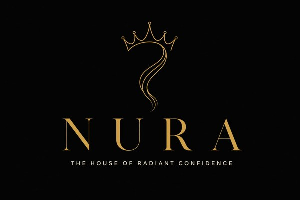
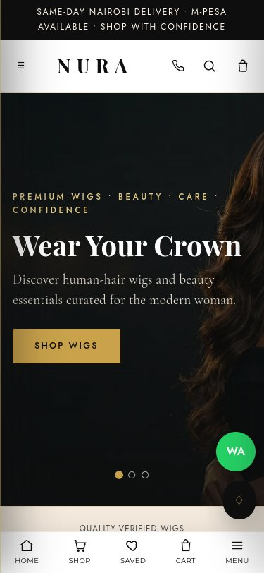
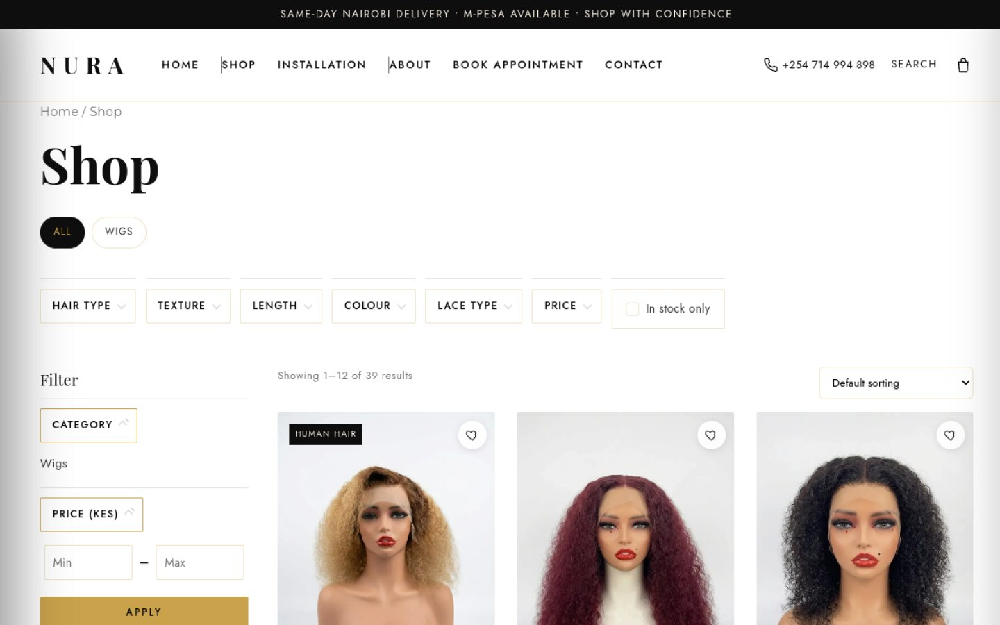
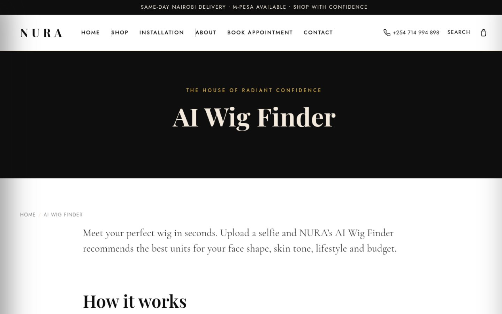

<div align="center">

> **Start here:** [PROJECT-STATUS.md](PROJECT-STATUS.md) - live versions, rules, what is done and what is next.



# NURA Beauty

**The House of Radiant Confidence**

Custom WordPress + WooCommerce storefront for **[nurabeauty.co.ke](https://nurabeauty.co.ke/)** - premium wigs, hair and beauty, hand-finished in Nairobi and built for how Kenyans shop online.

<br>

[](nura-beauty)
[](nura-experience)
[](https://nurabeauty.co.ke/)


<br>

**[Visit the store](https://nurabeauty.co.ke/)** &nbsp;&bull;&nbsp; [Shop](https://nurabeauty.co.ke/shop/) &nbsp;&bull;&nbsp; [AI Wig Finder](https://nurabeauty.co.ke/ai-wig-finder/) &nbsp;&bull;&nbsp; [Install](#installation) &nbsp;&bull;&nbsp; [Deploy](#deploying-an-update) &nbsp;&bull;&nbsp; [Releases](#release-history)

</div>

<br>

<p align="center">
  
  &nbsp;
  
</p>

<br>

## At a glance

| Packages | Payments | Delivery | Back office |
| :---: | :---: | :---: | :---: |
| Theme, child theme, plugin | M-Pesa, card (Paystack), M-Pesa Till 1679269, bank; pay in store on pick-up only | Same-day Nairobi before 5 PM, same-day dispatch countrywide | NURA Desk: till, orders, plans, bookings, sourcing, team |

## Documentation

| File | Contents |
| --- | --- |
| [PRD.md](PRD.md) | Product requirements and status |
| [ARCHITECTURE.md](ARCHITECTURE.md) | Full architecture, modules, data model, flows |
| [ARCHITECTURE-ESSENTIALS.md](ARCHITECTURE-ESSENTIALS.md) | One-page summary |
| [SECURITY-AUDIT.md](SECURITY-AUDIT.md) | Security controls, findings and maintenance checklist |
| [AGENTS.md](AGENTS.md) | Rules for developers and AI agents |
| [docs/AI-VISIBILITY.md](docs/AI-VISIBILITY.md) | Monthly AI-assistant visibility check: method, 20 questions, results |
| [HANDOVER.md](HANDOVER.md) | Current state, recent releases, server settings and open items - read first |

## Packages

| Folder | Version | Installed as |
| --- | --- | --- |
| `nura-beauty/` | 1.134.0 | Parent theme |
| `nura-beauty-child/` | - | Active child theme |
| `nura-experience/` | 1.109.3 | Plugin |

## Features

### Shopping
- Catalogue of human hair, blend and fibre wigs with colour swatches (10 shades) and per-colour photos.
- Live search, filters, quick view, mega menu, trust strips, Google reviews, journal guides.
- Checkout with required phone; pay on delivery (cash or M-Pesa) only within Nairobi CBD; everything else paid before dispatch; pay at the shop for studio pick-up.
- One-tap **Order on WhatsApp** with colour, quantity, county delivery quote, reference `NURA-YYMMDD-XXXX` and payment to **M-Pesa Buy Goods Till 1679269** (optional M-Pesa code capture, dispatch after verification).
- **Lipa Mdogo Mdogo**: 50% deposit today, balance within 1 or 2 weeks, published terms v2.0.
- AI stylist chat, AI wig finder, wig quiz and in-browser virtual try-on.
- **Studio bookings**: mornings only, 50% deposit by M-Pesa (minimum KSh 500), terms, 15-minute late rule; video and WhatsApp consultations free.
- My Account with order tracking, NURA Circle loyalty, care schedule, warranty certificates, e-mail 2-step verification and new-device alerts.

### NURA Desk (wp-admin)
Overview and daily digest, point of sale with receipts, WhatsApp/online orders, payment plans, appointments with the "Studio now" board, sourced sales and supplier ledger, reminders, marketing campaigns, social catalogue feeds, subscribers, team permissions and activity log, encrypted contacts vault, Excel and CSV exports.

### Security
Rate limiting on every public form and endpoint, input sanitisation, WordPress password hashing + 10-character policy, secrets from environment/constants, same-origin CORS, prepared SQL, staff session expiry, HTTPS redirect + HSTS, security headers incl. CSP `frame-ancestors`, safe uploads, `no-store` Desk screens, AES-256-GCM contact encryption, login lockout. See [SECURITY-AUDIT.md](SECURITY-AUDIT.md).

## Screenshots

| Shop with wig filters | AI Wig Finder |
| :---: | :---: |
|  |  |

## Collections

<table>
  <tr>
    <td align="center"><br><sub><b>Wigs</b><br>Human hair, blend, fibre</sub></td>
    <td align="center"><br><sub><b>HD Lace Front</b><br>Invisible hairline</sub></td>
    <td align="center"><br><sub><b>Ready-to-Wear</b><br>Glueless, everyday</sub></td>
    <td align="center"><br><sub><b>Bridal & Occasion</b><br>Made for the big day</sub></td>
    <td align="center"><br><sub><b>Confidence Line</b><br>Comfort first</sub></td>
  </tr>
</table>

## Project structure

```
nura-beauty/            parent theme
  functions.php         versions + module loader
  inc/                  setup, WooCommerce, SEO, security, login, boost, customizer
  page-*.php            page templates (booking, contact, about, wig finder...)
  assets/css, js        styles and scripts
  demo/                 sample content for the importer
nura-beauty-child/      child theme (active)
nura-experience/        plugin
  nura-experience.php   versions + class loader
  includes/             one class per feature (class-nura-desk-*.php = NURA Desk)
  assets/css, js, img   Desk and storefront assets
  samples/              product import template
docs/                   README images and screenshots
```

## Installation

Requirements: WordPress 6.2+, WooCommerce 8.0+, PHP 7.4+ (8.x recommended), HTTPS.

1. Upload `nura-beauty` then `nura-beauty-child` (Appearance > Themes > Add New > Upload) and activate the child theme.
2. Upload and activate `nura-experience` (Plugins > Add New > Upload).
3. Run Appearance > NURA Setup (plugins, sample content).
4. Install Paystack, add live keys and the webhook URL.
5. Fill NURA Desk > Settings: M-Pesa details, service prices, booking and payment-plan rules.
6. Add to `wp-config.php`: `FORCE_SSL_ADMIN`, `DISALLOW_FILE_EDIT` and the `NURA_DATA_KEY` shown in NURA Desk > Security.
7. Re-save Settings > Permalinks.

## Deploying an update

Commits to `main` do not deploy automatically.

1. Plugins > Add New > Upload the plugin zip > "Replace current with uploaded".
2. Appearance > Themes > Add New > Upload the theme zip > "Replace current with uploaded".
3. LiteSpeed Cache > Purge All, then Ctrl+F5.
4. Check versions in Plugins and Themes, then test on a phone: search, cart, checkout, WhatsApp order, booking, Desk till.

## Configuration

| Where | What |
| --- | --- |
| Customize > NURA Options | Brand, contact details, colours, fonts, homepage blocks |
| WooCommerce > Settings | Payments, shipping zones and free-delivery minimum |
| NURA Desk > Settings | M-Pesa details, booking hours, cut-off, deposit %, minimum, grace, hold hours, prices, payment-plan rules |
| NURA Desk > Team | Staff permissions (prices, discounts, refunds, mark paid, exports, delete) |
| Settings > NURA Experience | AI provider keys (or environment variables), WhatsApp number, loyalty |

### Environment variables / constants

| Name | Purpose |
| --- | --- |
| `NURAX_OPENAI_KEY`, `NURAX_GEMINI_KEY` | AI provider keys |
| WhatsApp token / app secret constants | Cloud API and webhook signature |
| `NURA_DATA_KEY` | Vault encryption key (32+ characters) |
| `NURAX_TRUSTED_PROXY_HEADER` | Real client IP behind Cloudflare/proxy |

## Shortcodes and REST API

Shortcodes: `[nura_ai_wig_finder]`, `[nura_wig_finder]`, `[nura_find_your_wig]`, `[nura_wig_quiz]`, `[nura_virtual_tryon]`, `[nura_booking_form]`, `[nura_contact_form]`, `[nura_circle_portal]`, `[nura_journal]`, `[nura_lookbook]`, `[nura_reviews]`, `[nura_google_reviews]`, `[nura_why_shop]`.

REST `nurax/v1`: `POST /wig-finder`, `POST /stylist`, `POST /stylist-booking`, `GET /slots?date=`, `GET /quickview?id=`, WhatsApp webhook. All public routes are rate-limited.

## Release history (recent)

| Theme | Plugin | Highlights |
| --- | --- | --- |
| 1.127.0 | - | UX pass: sticky buy bar follows the chosen colour and adds to bag; Lipa Mdogo Mdogo card line shows deposit + weeks; free-delivery line names the threshold; booking explains studio vs video/WhatsApp; Wig Finder copy matches its questions; empty cart has Shop wigs / wig care / Find my wig; filter results announced to screen readers |
| 1.126.0 | 1.109.3 | AI visibility for every product, now and future: real supplier brand (Luodais, Ghost Bond, CSCR ...) in schema, Brands terms and social feeds; full description in Product schema; own questions for wig care / beauty / tools (wig questions no longer shown on them); every product with brand, price and summary in /llms.txt |
| - | 1.108.1 | WhatsApp order pop-up: phone footer button no longer cut off at the right edge |
| - | 1.108.0 | Order on WhatsApp pop-up simplified: two steps (your details, then pay & send) with Continue / Back buttons, smaller header and one-row footer on phones, and a 'More below' hint while there is more to scroll |
| - | 1.107.1 | M-Pesa till name shown in the WhatsApp order pay box, payment steps and order message is now NURA CROWN & BEAUTY (what the customer's M-Pesa message shows) |
| 1.125.2 | - | Homepage tabs: no product repeats across New In / Best Sellers / Under KSh 5,000 (top-up only when the catalogue is too small); hidden tab panels ship in `<template>` and load on first use; Wig Care section nesting fixed on the homepage |
| - | 1.105.0 | Accounts: payment vouchers (PV/RV numbers) with several items on one receipt / M-Pesa code, edit whole voucher (ref, payee, date apply to all items), duplicate-reference guard, reason for changes, full change history; Excel Register shows voucher no. (built, install pending) |
| - | 1.104.0 | Expenses & income Excel report at P&L standard: Summary vs comparative, Register, Suppliers & methods, Notes / records to check |
| 1.125.1 | 1.103.1 | Delivery wording: same-day delivery in Nairobi, same-day dispatch countrywide (courier sets arrival); stored content migrated |
| 1.124.1 | 1.102.0 | Schema: breadcrumbs on all pages, one business entity; wig encyclopedia (44 terms) + 7 comparison guides linked from products, footer and llms.txt; on-site review requests; Accounts comparative statement + IAS 1 Excel export |
| 1.112.0 | 1.94.0 | Pay on delivery within Nairobi CBD only (checkout + WhatsApp pop-up); M-Pesa PIN prompt via Paystack in the WhatsApp pop-up; site-wide payment/delivery wording |
| 1.111.0 | 1.93.0 | Wigs from KSh 1,800; price tables exclude wig care; buying guide rewritten with checked market prices |
| 1.73.0 | 1.79.0 | No cash on delivery; WhatsApp orders paid to M-Pesa Till 1679269; professional order message; pay-at-shop for pick-up only |
| 1.72.0 | 1.77.1 | Self-hosted login fonts; payment-code label fix |
| - | 1.77.0 | WhatsApp receipts for website orders, no duplicate till e-mails, contact fallback, sent badges, billed bookings |
| - | 1.76.0 | Void sales, part payments, bill a booking from the till, automatic receipts |
| 1.71.0 | 1.75.0 | Self-hosted fonts, minified JS, one payment code one use, staff idle logout |
| - | 1.74.0-1.74.1 | Database connection load guard, compact subscribe pop-up |
| - | 1.73.8-1.73.9 | /review link, Review button, fallback Google Place ID |
| 1.64.0 | 1.73.1 | Security hardening module, upload safety, CSP frame-ancestors, no-store Desk, AJAX limits, CSV-injection and cookie fixes, full documentation refresh |
| 1.63.0 | 1.72.0 | Booking loophole fixes (WhatsApp bypass, fake/reused M-Pesa codes, slot holds, past times, duplicates), plan deposit floor, till safeguards |
| 1.62.0 | 1.71.0 | Morning bookings with deposit, terms and arrival board; Lipa Mdogo Mdogo 50% / 2 weeks, terms v2.0 |
| - | 1.70.0 | Sourced sales, supplier ledger, Team page redesign |
| 1.53.0 | 1.55.0 | First security audit: login lockout, password policy, sessions, HTTPS, CORS |

## Business

NURA Beauty - The House of Radiant Confidence. Stanbank House, 2nd Floor, Room 20, Nairobi CBD. WhatsApp +254 714 994 898. [nurabeauty.co.ke](https://nurabeauty.co.ke/)

License: GPLv2 or later.
