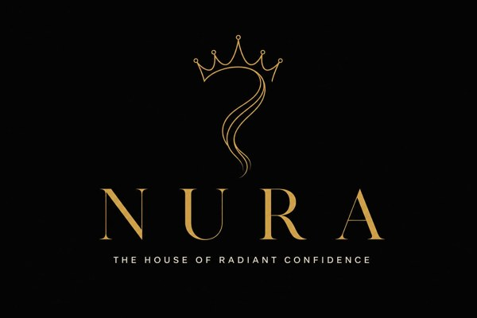
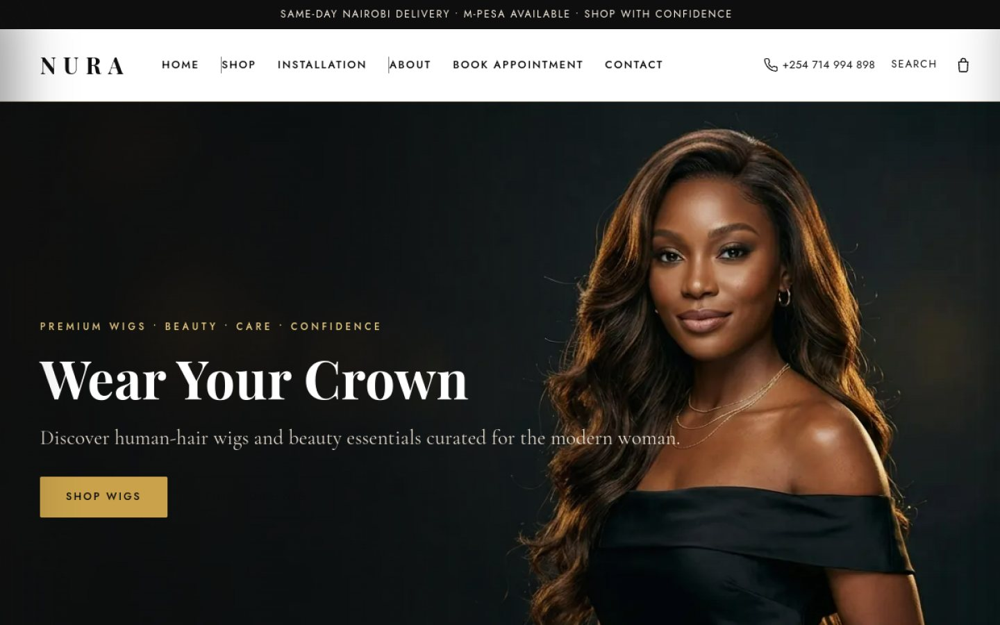
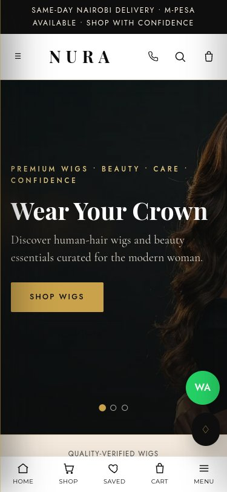
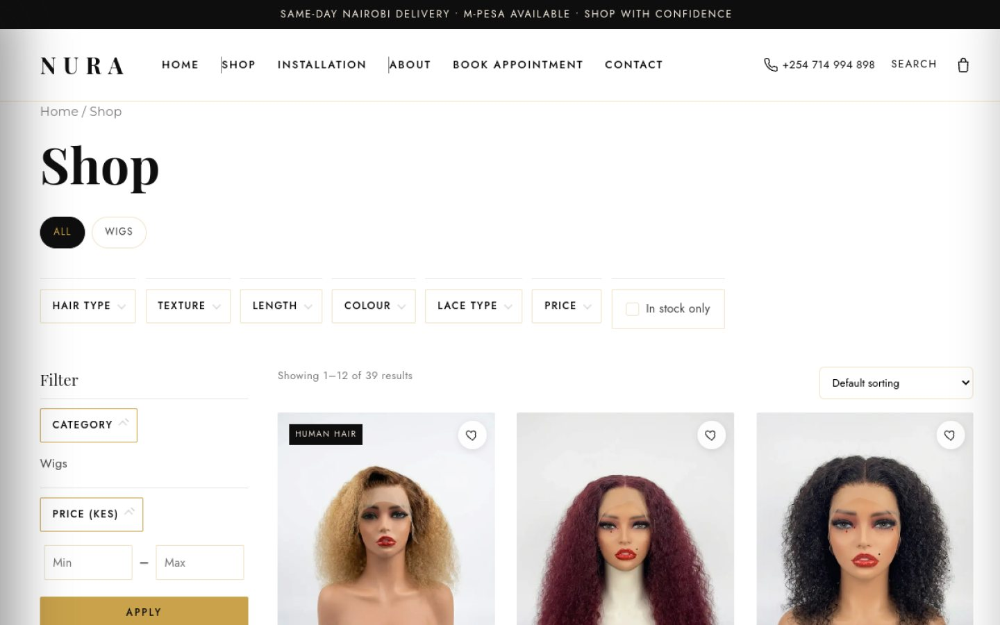
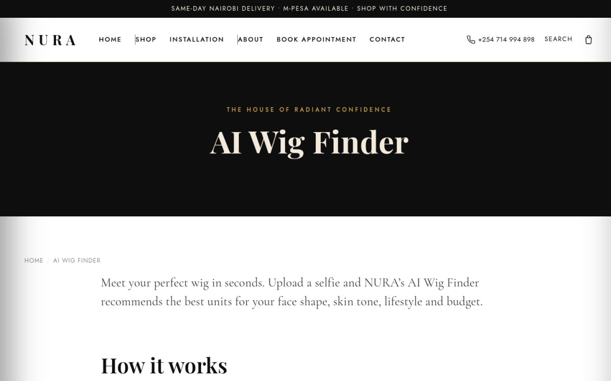

<div align="center">



# NURA Beauty

**The House of Radiant Confidence**

Custom WordPress + WooCommerce storefront for **[nurabeauty.co.ke](https://nurabeauty.co.ke/)** - premium wigs, hair and beauty, hand-finished in Nairobi and built for how Kenyans shop online.

<br>

[](nura-beauty)
[](nura-experience)
[](https://nurabeauty.co.ke/)


<br>

**[Visit the store](https://nurabeauty.co.ke/)** &nbsp;&bull;&nbsp; [Shop](https://nurabeauty.co.ke/shop/) &nbsp;&bull;&nbsp; [AI Wig Finder](https://nurabeauty.co.ke/ai-wig-finder/) &nbsp;&bull;&nbsp; [Install](#installation) &nbsp;&bull;&nbsp; [Deploy](#deploying-an-update) &nbsp;&bull;&nbsp; [Releases](#release-history)

</div>

<br>

<p align="center">
  
  &nbsp;
  
</p>

<br>

## At a glance

| Packages | Payments | Delivery | Back office |
| :---: | :---: | :---: | :---: |
| Theme, child theme, plugin | M-Pesa, card (Paystack), bank, COD Nairobi | Same-day Nairobi before 5 PM, 1-3 days countrywide | NURA Desk: till, orders, plans, bookings, sourcing, team |

## Documentation

| File | Contents |
| --- | --- |
| [PRD.md](PRD.md) | Product requirements and status |
| [ARCHITECTURE.md](ARCHITECTURE.md) | Full architecture, modules, data model, flows |
| [ARCHITECTURE-ESSENTIALS.md](ARCHITECTURE-ESSENTIALS.md) | One-page summary |
| [SECURITY-AUDIT.md](SECURITY-AUDIT.md) | Security controls, findings and maintenance checklist |
| [AGENTS.md](AGENTS.md) | Rules for developers and AI agents |

## Packages

| Folder | Version | Installed as |
| --- | --- | --- |
| `nura-beauty/` | 1.64.0 | Parent theme |
| `nura-beauty-child/` | - | Active child theme |
| `nura-experience/` | 1.73.0 | Plugin |

## Features

### Shopping
- Catalogue of human hair, blend and fibre wigs with colour swatches (10 shades) and per-colour photos.
- Live search, filters, quick view, mega menu, trust strips, Google reviews, journal guides.
- Checkout with required phone; cash on delivery offered and enforced for Nairobi only.
- One-tap **Order on WhatsApp** with colour, quantity, county delivery quote and reference `NURA-YYMMDD-XXXX`.
- **Lipa Mdogo Mdogo**: 50% deposit today, balance within 1 or 2 weeks, published terms v2.0.
- AI stylist chat, AI wig finder, wig quiz and in-browser virtual try-on.
- **Studio bookings**: mornings only, 50% deposit by M-Pesa (minimum KSh 500), terms, 15-minute late rule; video and WhatsApp consultations free.
- My Account with order tracking, NURA Circle loyalty, care schedule, warranty certificates, e-mail 2-step verification and new-device alerts.

### NURA Desk (wp-admin)
Overview and daily digest, point of sale with receipts, WhatsApp/online orders, payment plans, appointments with the "Studio now" board, sourced sales and supplier ledger, reminders, marketing campaigns, social catalogue feeds, subscribers, team permissions and activity log, encrypted contacts vault, Excel and CSV exports.

### Security
Rate limiting on every public form and endpoint, input sanitisation, WordPress password hashing + 10-character policy, secrets from environment/constants, same-origin CORS, prepared SQL, staff session expiry, HTTPS redirect + HSTS, security headers incl. CSP `frame-ancestors`, safe uploads, `no-store` Desk screens, AES-256-GCM contact encryption, login lockout. See [SECURITY-AUDIT.md](SECURITY-AUDIT.md).

## Screenshots

| Shop with wig filters | AI Wig Finder |
| :---: | :---: |
|  |  |

## Collections

<table>
  <tr>
    <td align="center"><br><sub><b>Wigs</b><br>Human hair, blend, fibre</sub></td>
    <td align="center"><br><sub><b>HD Lace Front</b><br>Invisible hairline</sub></td>
    <td align="center"><br><sub><b>Ready-to-Wear</b><br>Glueless, everyday</sub></td>
    <td align="center"><br><sub><b>Bridal & Occasion</b><br>Made for the big day</sub></td>
    <td align="center"><br><sub><b>Confidence Line</b><br>Comfort first</sub></td>
  </tr>
</table>

## Project structure

```
nura-beauty/            parent theme
  functions.php         versions + module loader
  inc/                  setup, WooCommerce, SEO, security, login, boost, customizer
  page-*.php            page templates (booking, contact, about, wig finder...)
  assets/css, js        styles and scripts
  demo/                 sample content for the importer
nura-beauty-child/      child theme (active)
nura-experience/        plugin
  nura-experience.php   versions + class loader
  includes/             one class per feature (class-nura-desk-*.php = NURA Desk)
  assets/css, js, img   Desk and storefront assets
  samples/              product import template
docs/                   README images and screenshots
```

## Installation

Requirements: WordPress 6.2+, WooCommerce 8.0+, PHP 7.4+ (8.x recommended), HTTPS.

1. Upload `nura-beauty` then `nura-beauty-child` (Appearance > Themes > Add New > Upload) and activate the child theme.
2. Upload and activate `nura-experience` (Plugins > Add New > Upload).
3. Run Appearance > NURA Setup (plugins, sample content).
4. Install Paystack, add live keys and the webhook URL.
5. Fill NURA Desk > Settings: M-Pesa details, service prices, booking and payment-plan rules.
6. Add to `wp-config.php`: `FORCE_SSL_ADMIN`, `DISALLOW_FILE_EDIT` and the `NURA_DATA_KEY` shown in NURA Desk > Security.
7. Re-save Settings > Permalinks.

## Deploying an update

Commits to `main` do not deploy automatically.

1. Plugins > Add New > Upload the plugin zip > "Replace current with uploaded".
2. Appearance > Themes > Add New > Upload the theme zip > "Replace current with uploaded".
3. LiteSpeed Cache > Purge All, then Ctrl+F5.
4. Check versions in Plugins and Themes, then test on a phone: search, cart, checkout, WhatsApp order, booking, Desk till.

## Configuration

| Where | What |
| --- | --- |
| Customize > NURA Options | Brand, contact details, colours, fonts, homepage blocks |
| WooCommerce > Settings | Payments, shipping zones and free-delivery minimum |
| NURA Desk > Settings | M-Pesa details, booking hours, cut-off, deposit %, minimum, grace, hold hours, prices, payment-plan rules |
| NURA Desk > Team | Staff permissions (prices, discounts, refunds, mark paid, exports, delete) |
| Settings > NURA Experience | AI provider keys (or environment variables), WhatsApp number, loyalty |

### Environment variables / constants

| Name | Purpose |
| --- | --- |
| `NURAX_OPENAI_KEY`, `NURAX_GEMINI_KEY` | AI provider keys |
| WhatsApp token / app secret constants | Cloud API and webhook signature |
| `NURA_DATA_KEY` | Vault encryption key (32+ characters) |
| `NURAX_TRUSTED_PROXY_HEADER` | Real client IP behind Cloudflare/proxy |

## Shortcodes and REST API

Shortcodes: `[nura_ai_wig_finder]`, `[nura_wig_finder]`, `[nura_find_your_wig]`, `[nura_wig_quiz]`, `[nura_virtual_tryon]`, `[nura_booking_form]`, `[nura_contact_form]`, `[nura_circle_portal]`, `[nura_journal]`, `[nura_lookbook]`, `[nura_reviews]`, `[nura_google_reviews]`, `[nura_why_shop]`.

REST `nurax/v1`: `POST /wig-finder`, `POST /stylist`, `POST /stylist-booking`, `GET /slots?date=`, `GET /quickview?id=`, WhatsApp webhook. All public routes are rate-limited.

## Release history (recent)

| Theme | Plugin | Highlights |
| --- | --- | --- |
| 1.64.0 | 1.73.0 | Security hardening module, upload safety, CSP frame-ancestors, no-store Desk, AJAX limits, CSV-injection and cookie fixes, full documentation refresh |
| 1.63.0 | 1.72.0 | Booking loophole fixes (WhatsApp bypass, fake/reused M-Pesa codes, slot holds, past times, duplicates), plan deposit floor, till safeguards |
| 1.62.0 | 1.71.0 | Morning bookings with deposit, terms and arrival board; Lipa Mdogo Mdogo 50% / 2 weeks, terms v2.0 |
| - | 1.70.0 | Sourced sales, supplier ledger, Team page redesign |
| 1.53.0 | 1.55.0 | First security audit: login lockout, password policy, sessions, HTTPS, CORS |

## Business

NURA Beauty - The House of Radiant Confidence. Imenti House, Moi Avenue, Nairobi CBD. WhatsApp +254 714 994 898. [nurabeauty.co.ke](https://nurabeauty.co.ke/)

License: GPLv2 or later.
